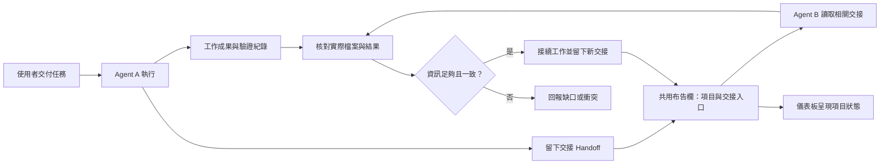
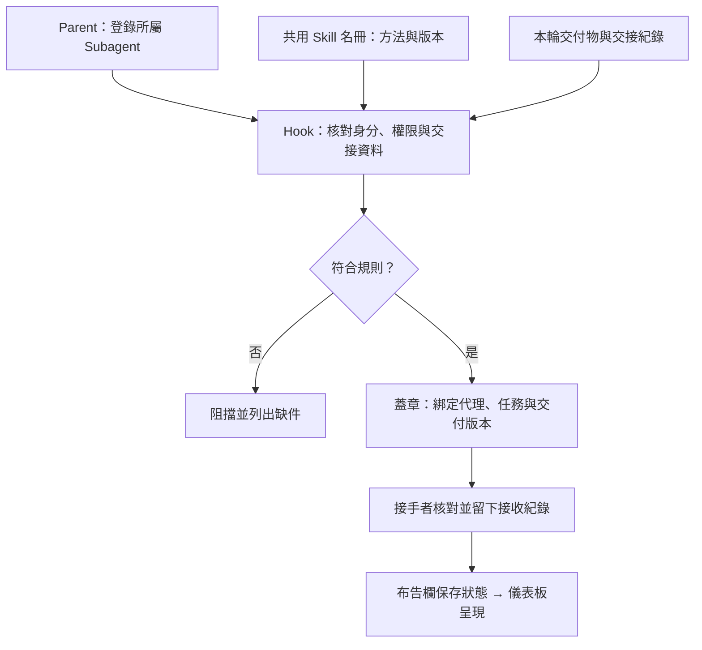
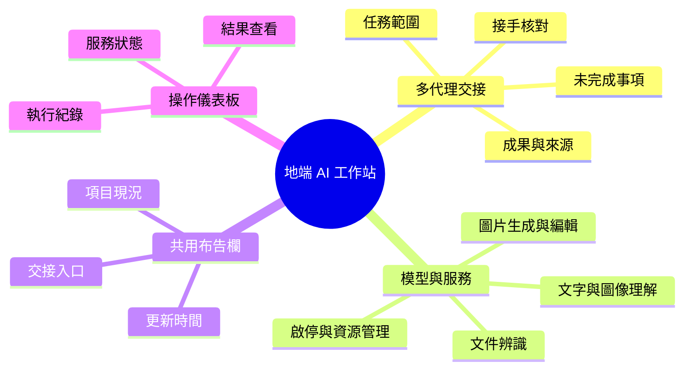

# 地端 AI 工作站：模型整合與多代理交接

**讓不同 Agent 在同一個項目接續工作：知道前一位做了什麼、成果在哪裡，以及接下來需要核對什麼。**

這個工作站把本機模型、Agent 工具、共用布告欄與操作儀表板放在同一個工作環境。預期流程是：使用者交付任務，Agent 執行並留下交接資訊；下一位讀取相關紀錄、核對成果，再接續處理。

目前已有共用布告欄 MVP、服務管理與儀表板實作。交接仍依賴使用者轉述、提醒或 Agent 主動查閱，沒有強制每位 Agent 都讀寫交接，也尚未驗證無人提醒的跨代理接手。

## 一個工作怎麼接下去？

以「替工作站新增文件處理功能」為例，以下是設計示意，不是已完成的 CC／Codex 自動交接實驗。

| 階段 | 留下或讀取什麼 | 下一步 |
|---|---|---|
| Agent A 完成第一部分 | 已改檔案、執行方法、測試結果、未完成事項 | 留下交接紀錄與成果位置 |
| 共用布告欄 | 這個項目的現況、更新時間、交接與來源入口 | 讓下一位找到正確項目 |
| Agent B 接手 | 先讀交接，再核對檔案版本與測試紀錄 | 確認能接手，或回報缺少的資訊 |
| Agent B 完成下一部分 | 本次修改、實際檢查、仍待處理事項 | 留下自己的交接，供後續接續 |
| 使用者查看儀表板 | 最近活動、工作狀態、成果與來源入口 | 判斷是否需要介入 |

[打開一份交接範例](handoff-example.md)

## 每位 Agent 交接什麼？

交接是一份能接續工作的短紀錄，不需要重貼整段聊天。

- **任務與範圍**：這輪要完成什麼，有哪些限制。
- **已完成事項**：具體改了哪些內容，交付物在哪裡。
- **驗證結果**：執行過什麼檢查，哪些尚未測試。
- **未完成與阻礙**：卡在哪裡，需要誰提供什麼。
- **接手入口**：先看哪份檔案、哪個版本或哪段紀錄。
- **接手確認**：下一位實際讀了什麼、核對到什麼，是否與交接一致。

這是本作品建議的交接格式。現有布告欄具備狀態、負責者、時間與來源欄位，但不代表每份既有紀錄都已填齊上述內容。

上圖是交接規約，不是自動派工引擎。角色 A、B 可由不同工具或不同次 session 擔任；目前仍可能需要使用者指定誰接手。

## 多代理協作管理規則

**各 parent 管自己的 subagent，共用同一份 Skill 名冊；交接以 hook 檢查與蓋章作為必要關卡。** 這一節定義管理規約，尚未接入真實 Codex／Claude Code 的強制執行設定。

### 代理名冊：誰負責、誰能做什麼

每個 parent（主代理）維護所屬 subagent（子代理）的名冊。代理識別由「parent ID＋subagent ID」組成，避免不同 parent 下的同名角色被混用。

| 名冊欄位 | 管理規則 |
|---|---|
| Parent / 主代理 | 負責派工、登錄與停用自己的 subagent，承接對外交接責任 |
| Subagent / 子代理 | 記錄識別、角色、所屬 parent 與啟用狀態 |
| Scope / 工作範圍 | 列出可操作的項目、檔案範圍與可使用的 Skill |
| Stamp identity / 印章識別 | 每位代理有獨立識別；不得借用其他 parent 或代理的印章 |
| Reviewer / 審查者 | 與產出者分開記錄；產出者不能替自己填寫獨立審查通過 |

跨 parent 協作透過交接紀錄承接，不因共用工作目錄就繼承對方的代理身分或權限。代理停用後不得提交新交接，既有紀錄保留以供追溯。

### Skill 名冊：共用方法，按任務載入

Skill（任務方法）集中登錄，供不同 parent 引用；各代理不必維護互相漂移的副本。

| 名冊欄位 | 管理規則 |
|---|---|
| Skill ID / 功能名稱 | 唯一識別與一句話用途 |
| Version / 版本 | 交接記錄實際採用版本；更新後保留舊版本對照 |
| Entry / 載入入口 | 指向方法定義與適用條件，符合任務才載入 |
| Input / Output / 輸入輸出 | 明訂必要材料、交付格式與檢查條件 |
| Owner / Status / 維護者與狀態 | 記錄維護責任及啟用、停用狀態；使用權限仍依代理名冊判斷 |

共用的是方法定義，不是任務內文、執行狀態或存取權限。交接只引用 Skill ID、版本與必要來源，不重貼整份 Skill 或全部聊天紀錄。

### Hook 蓋章：交接必經的檢查規則

Hook（事件檢查入口）設定在「提交交接」與「確認接手」兩個節點，避免每次對話都重複載入整套規則。

1. **提交前核對**：parent 與 subagent 必須存在且啟用；工作範圍、Skill 權限及版本必須符合名冊。
2. **交接資料齊備**：必須有任務範圍、交付物入口、檢查紀錄、未完成事項及下一位的接手入口。未檢查的內容須明示。
3. **由 hook 蓋章**：檢查通過後，由程式產生交付印章，綁定代理識別、任務、Skill 版本、交付物版本與時間。Agent 自行寫「已蓋章」不算有效。
4. **缺件即阻擋**：名冊不符、來源缺失或檢查失敗時，不得轉成已交接；回傳缺件原因供原代理補正。
5. **接手另行確認**：接手者核對印章與實際交付物，另留接收紀錄。內容或版本有變，須重新檢查與蓋章。

印章表示該版本符合交接規則；內容品質由 Reviewer 另行審查。布告欄保存交接入口與狀態，儀表板讀取並呈現「待補件、待接手、已接手」，不自行判定審查通過。

## 工作站由哪些部分組成？

| 部分 | 用途 | 與交接的關係 |
|---|---|---|
| 本機文字與多模態模型 | 處理文字或圖像輸入 | 交接記錄使用的模型、輸入與產出，避免換模型後誤認為相同結果 |
| 專用處理服務 | OCR、圖片生成與編輯等不同用途 | 分開記錄各項服務的設定與驗證狀態 |
| Agent 與工具 | 操作工作材料、呼叫服務、執行程式 | 交接規約要求執行者留下本輪成果與未完成事項；目前未強制 |
| 共用布告欄 | 保存項目現況及來源入口 | 下一位知道從哪裡接續 |
| 操作儀表板 | 提供服務入口，顯示執行與驗收資訊 | 使用者能看見狀態並回查依據 |

多模態描述能處理哪些資料，專用服務描述工作用途；Agent 則負責使用模型與工具。三者分開呈現。

## 儀表板怎麼設計？

儀表板需要回答三個問題：**現在誰在做什麼？做到哪裡？成果在哪裡？**

現有介面已有工作總覽、模型與服務、執行與驗收、來源查看等入口；布告欄讀取端會提供來源及更新資訊。各項目依既有資料來源呈現，不能假設所有任務都已統一走布告欄。

本作品會把「執行者回報完成」與「接手者已核對」分開。這個區別目前先寫入示例，尚未接成儀表板的自動驗收功能。儀表板上的完成標記不取代原始成果與檢查紀錄。

## 模型與資源管理

本機環境為 Apple Silicon、48 GB 記憶體。工作站提供統一服務入口，按需要載入或關閉模型，並將模型端點與設定集中登錄。Agent 可使用這些服務處理文字、文件或圖片任務。

地端是工作資料與部分運算的部署位置。Codex、Claude Code 或外部模型服務的使用不因此變成完全離線；涉及外部 API 的流程仍需分別說明資料傳送範圍。

## 現況與限制

| 項目 | 目前能確認的範圍 |
|---|---|
| 共用布告欄 | 已有文件結構、來源欄位與讀取程式；規約不等於強制執行 |
| 多代理交接 | 使用者轉述與共用檔案可提供接手資訊；無人提醒的完整交接尚未驗證 |
| 本機模型 | 已有服務登錄、啟停入口與部分連線驗收；各模型能力需分別測試 |
| 圖片工作室 | 既有狀態記錄顯示介面與流程架構完成，實際生成品質仍待驗證 |
| 儀表板 | 已有介面與來源讀取程式；本輪未重跑全部操作流程 |
| Hook 與協作控制 | 已定義兩份名冊、交接檢查與蓋章規約；執行整合及跨 Agent 檔案鎖定尚未完成 |

此目錄目前是獨立作品草稿與教學示例，未包含完整工作站安裝包。元件現況根據既有程式與紀錄整理，不是本輪重新部署的驗收結果。

## 技術棧

| English | 中文用途 |
|---|---|
| Python / Shell | 服務控制、資料讀取與操作工具 |
| Markdown / YAML / JSON | 交接內容、狀態與來源描述 |
| HTML / CSS / JavaScript | 操作儀表板與結果呈現 |
| MLX / local model endpoints | Apple Silicon 本機模型推論服務 |
| Agent harness | 讓模型使用工具、讀寫材料的執行環境 |
| Git | 核對檔案版本與修改歷史 |

Author: Nio (Master) · Drafting: Codex · 2026-10-23
